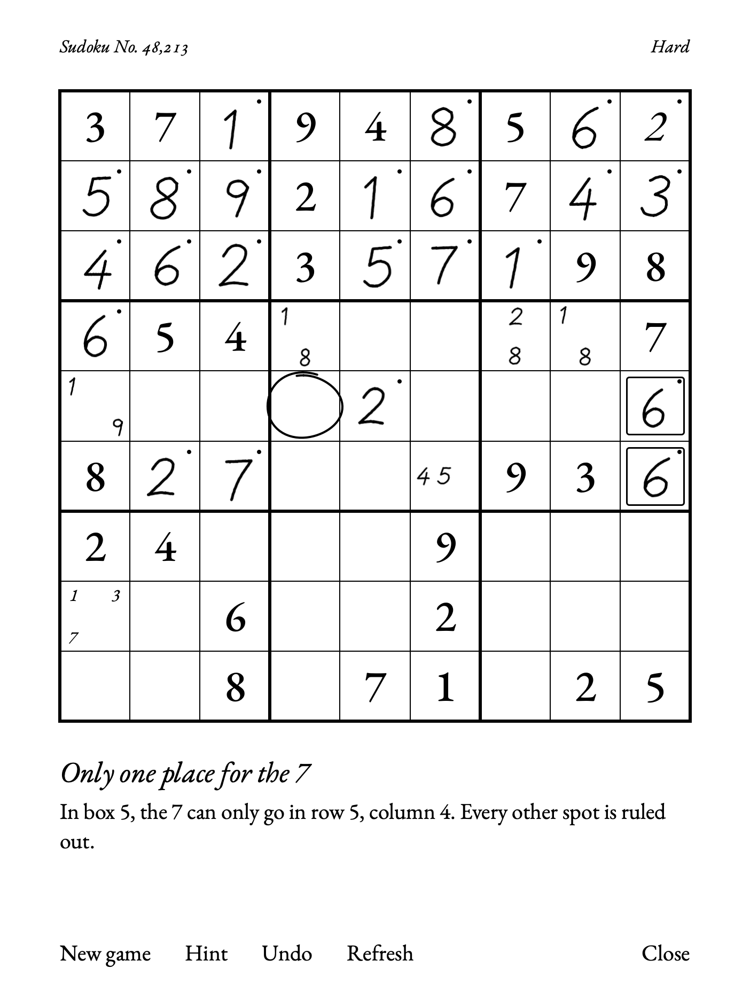
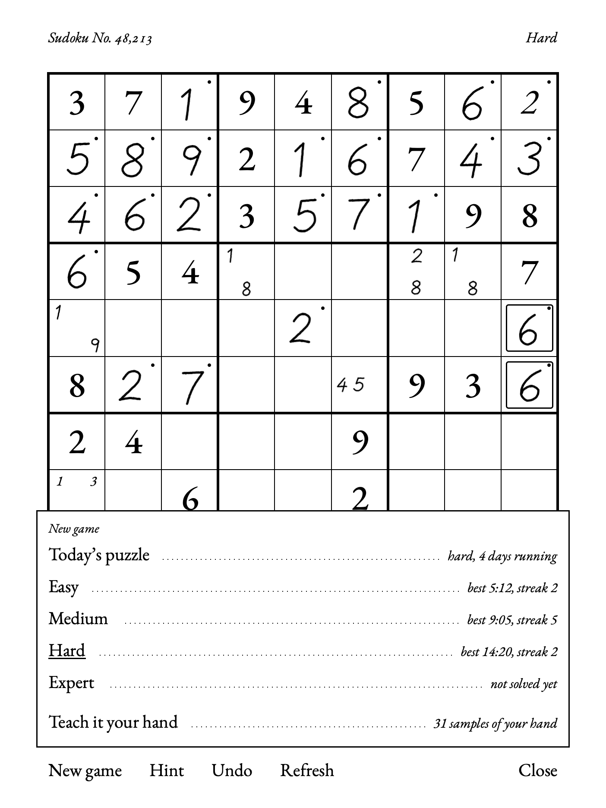
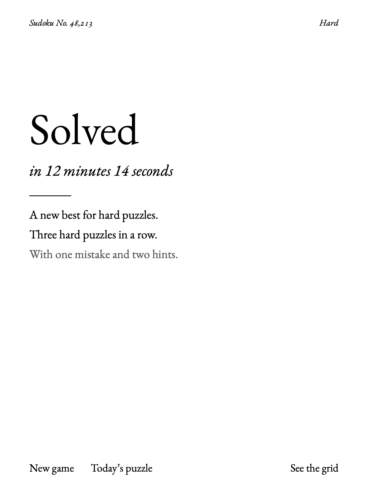

# Ink Sudoku

Pen-only Sudoku for the reMarkable Paper Pure. There's no number pad. You write
your answers in the grid with the Marker and they stay there in your own
handwriting, like on paper.

<p>



</p>

- **Write big for an answer, small in a corner for a pencil mark, scratch over
  ink to erase it.** A small on-device digit recognizer (an int8 CNN, about
  0.3 ms per digit) reads what you write. Ink it can't read fades, so it never
  guesses.
- **Teach it your hand.** Write 1 to 9 three times on the calibration page.
  It learns your writing on the tablet, and keeps learning from any answer you
  rewrite.
- **Endless puzzles, graded the way a person solves them.** A seeded generator
  checks every puzzle has exactly one solution. Easy, Medium, Hard and Expert
  are graded by the techniques a person needs, from singles up to X-wings,
  swordfish, colouring and XY-wings. Plus a daily puzzle.
- **Play by number.** Every puzzle has a number ("Hard No. 482,137"). Write
  it into the New game list and tap a level to play that exact puzzle, or to
  race a friend on the same one. Replays stay out of your best times.
- **Hints that teach.** The first press names the idea ("Only one place for
  the 7"). The second explains it and marks the cells. Mistakes in your
  answers or your notes are pointed out.
- **Made for e-ink.** Quiet partial refreshes while you play. Tap Refresh for a
  quiet clean-up; hold it for a full flash.
- Undo, a timer that pauses while the tablet sleeps, best times and streaks per
  level.

Everything runs on the tablet. Nothing goes over the network, and your
handwriting samples stay in `/home/root/.local/share/ink-sudoku/`.

**Ink Kakuro** (`kakuro-app/`, [KAKURO.md](KAKURO.md)) is a second app built on
the same pen and recognition code: 7×7 to 13×13 grids with graded puzzles and
the same pencil marks and hints. It's newer and has had much less play.

## Compatibility

Tested on a **reMarkable Paper Pure, firmware 3.29.1.0**. The Paper Pro and
Move may work (the app finds the pen and screen size at runtime), but nobody
has tried, and the
layout was designed for the Pure's 1404×1872 screen. The reMarkable 1 and 2
are not supported.

## Install

You need developer mode, plus [xovi](https://github.com/asivery/xovi) and
[AppLoad](https://github.com/asivery/rm-appload). The usual way to get both is
the [Vellum](https://github.com/vellum-dev/vellum) package manager. Don't use
Toltec on the Paper Pro, Pure or Move.

1. Download `ink-sudoku.zip` from the [latest release](../../releases/latest)
   and unzip it.
2. Copy the `ink-sudoku` folder to the tablet:
   ```sh
   scp -O -r ink-sudoku root@10.11.99.1:/home/root/xovi/exthome/appload/
   ```
3. On the tablet, open AppLoad and tap **Reload**. Ink Sudoku appears in the
   list.

Ink Kakuro installs the same way from `ink-kakuro.zip`.

To uninstall, delete `/home/root/xovi/exthome/appload/ink-sudoku`. Your saved
game, stats and handwriting samples are in `/home/root/.local/share/ink-sudoku`.

## Known issue: closing the app

Now and then, tapping **Close** can make the reMarkable interface restart. Your game
is saved after every move, so nothing is lost. The cause is a race in AppLoad itself: it
tears an app down from two threads at once without a lock. The app shuts its
side down cleanly to make this less likely, but the real fix has to come from
AppLoad.

## Building from source

The toolchain comes from [pixi](https://pixi.sh): Go, Qt 6 for `rcc` and the
offscreen screenshot harness. `pixi.toml` currently lists macOS on Apple
silicon only. Go code is stdlib only and cross-compiles to a static
`linux/arm64` binary.

```sh
cd backend && pixi run go test ./...             # whole suite, a few seconds
./app/build.sh                                    # -> dist/ink-sudoku
./kakuro-app/build.sh                             # -> dist/ink-kakuro
scripts/deploy-app.sh dist/ink-sudoku [ssh-host]  # copy to the tablet, then Reload in AppLoad
```

Puzzle generator stats:
```sh
cd backend && pixi run go run ./cmd/sudokugen -level all -n 200 -q
```

Screenshots on the Mac, with stubbed AppLoad modules in `dev/stubs`. For true
fonts, put the EB Garamond variable TTFs in `dev/fonts/`:
```sh
QT_QPA_PLATFORM=offscreen .pixi/envs/default/bin/qml6 -I dev/stubs dev/shot.qml -- [--hint] "$PWD/app/ui/main.qml" /tmp/shot.png
# more screens: --chooser --teach --teach-finish --ink --ink-many N --solved (see the header of dev/shot.qml)
```

Replaying a real backend session through the QML app:
```sh
cd backend && INK_FIXTURES=$PWD/../dev/fixtures pixi run go test ./cmd/sudoku -run Fixtures
QT_QPA_PLATFORM=offscreen .pixi/envs/default/bin/qml6 -I dev/stubs dev/shot.qml -- --replay [N] "$PWD/app/ui/main.qml" /tmp/replay.png
```

The recognizer's training pipeline is in [hwrtrain/](hwrtrain/README.md).

## Layout

```
backend/            Go module (stdlib only, static linux/arm64)
  appload/          AppLoad backend socket protocol (PROTOCOL.md)
  pen/              stylus evdev reader (reads alongside xochitl, never grabs)
  display/          follows xochitl's display state (pauses the timer while asleep)
  engine/           Sudoku generator, solver, human-technique grader, hints
  game/             one game: ink, pencil marks, undo, timer, saving
  hwr/              stroke rasterizer, int8 digit CNN, ink analysis, personalization
  kakuro/ kgame/    the same for Kakuro
  cmd/sudoku/       Ink Sudoku backend      cmd/kakuro/   Ink Kakuro backend
  cmd/sudokugen/    generator CLI           cmd/probe/    pen/ink latency probe
app/                Ink Sudoku QML frontend, manifest, icon; build.sh
kakuro-app/         Ink Kakuro QML frontend
probe/              probe app: ink latency per display mode
hwrtrain/           Python (uv) training and fine-tuning for hwr/model.bin
dev/                Mac stubs for AppLoad's QML modules, screenshot and replay harness
scripts/            deploy-app.sh
```

## License

MIT, see [LICENSE](LICENSE). The recognizer was trained on public
handwriting datasets, which are credited in [NOTICE](NOTICE). This project
contains no code from other reMarkable game projects. AppLoad's protocol was
implemented from its documentation.
